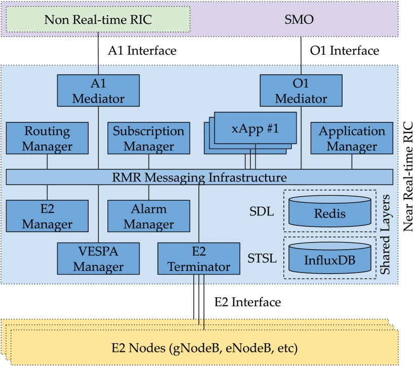
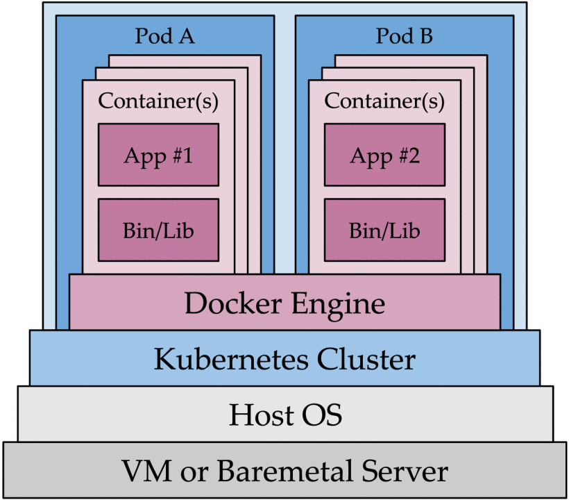

# xApp Developement Guide

<table>
  <tr>
    <td align="center" width="50%">
      
       
      <b>(a)</b> Architecture of Near-RT RIC.
    </td>
    <td align="center" width="50%">
      
       
      <b>(b)</b> Deployment layers of xApps.
    </td>
  </tr>
</table>

  Figures taken from [1].

This repo contains tutorials, learning content, and code for building xApps. It will evolve as I learn more!

## Phases

### Phase 1: Environment Setup
I have aimed to setup the whole infrastructure for xApp developement as code (IaC) to make it reproducible.

* **Setting Up The VMs**: Three VMs are created using  [Terraform + Multipass](./DevOps/k8s-multipass-terraform/). The VMs are described using Terraform and each have a cloud-init file which makes them ready for k8s components and joins them to the cluster. When `terraform apply` is done, your K8s cluster is up and running. Furthermore, Terraform generates the `inventory.yaml` file that [Ansible](./DevOps/ansible-near-rt-ric/) is gonna use next.

* **Deploying Near-RT RIC components**: Then I am deploying Near-RT RIC based on the [O-RAN documentations](./ric-dep/new-installer/README.md), to make it reproducible, I have been using  to setup the nodes, local helm repository, and installing Near RT RIC helm charts. I followed the each step [ric-dep new-installer documentation](./ric-dep/new-installer/README.md) and translated it to Ansible playbooks, roles and tasks. There are some places for improvement which I will do over time. 

* **Deploying E2 Simulator**: To simulate the data that RAN feeds to RIC, we need to use an E2 simulator which connects to the E2-Termination service and provides metrics allowing xApps to get feedback when they change a parameter. This step is done by building the [Docker image](./e2-interface/e2sim/Dockerfile_kpm) at e2-interface repo and then manually pushing it to my own dockerhub. It's very ugly and I will soon fix it. 

* **Install xApp Onboarder**: We install the `dms_cli` tool from the [appmgr](https://gerrit.o-ran-sc.org/r/ric-plt/appmgr) and use it to onboard an install a new xApp.

### Phase 2: Adding The First xApp

## References

[1] J. F. Santos, A. Huff, D. Campos, K. V. Cardoso, C. B. Both, and L. A. DaSilva, "Managing O-RAN Networks: xApp Development From Zero to Hero," *IEEE Communications Surveys & Tutorials*, vol. 28, pp. 800–840, 2026, doi: [10.1109/COMST.2025.3539687](https://doi.org/10.1109/COMST.2025.3539687).